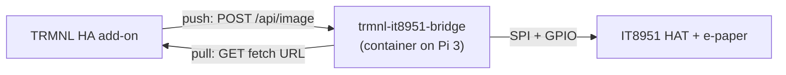

# trmnl-it8951-bridge

Show Home Assistant dashboards rendered by the
[TRMNL HA add-on](https://github.com/usetrmnl/trmnl-home-assistant) on a
Waveshare IT8951 e-paper panel (reference: 9.7", 1200×825) connected to a Raspberry Pi 3.

- **Push and pull:** the add-on can POST images to this service, and the service can fetch images from the add-on. Both can run at the same time.
- **Partial updates:** only changed rectangles are refreshed, with a full refresh every *N* updates against ghosting.
- **Status page, health endpoint and current image**, configured via a YAML file and/or environment variables.

This is an unofficial community project, not affiliated with TRMNL or Waveshare.

> Status: v0.1.0 implemented and tested against a simulated panel. The hardware path was verified
> with the [smoke test](docs/hardware-smoke-test.md); the container hasn't run on the Pi yet.
> Docs: [requirements](docs/requirements.md), [design](docs/design.md),
> [configuration](docs/configuration.md), [decisions (ADRs)](docs/adr/README.md).



## Host requirements

Everything below is assumed to be in place. The container does not check or change host settings.

### Hardware

- Raspberry Pi 3 (B/B+) running **Raspberry Pi OS Lite 64-bit (bookworm)** or another arm64 distribution with the Raspberry Pi kernel.
- Waveshare IT8951 e-Paper HAT set to **SPI** mode (check the interface switch/resistor on the HAT) and attached to the 40-pin header.
- The panel's **VCOM value**, printed on its FPC cable (e.g. `-1.50`). You need it for the configuration.

Pins used (BCM numbering): SPI0 MOSI/MISO/SCLK (10/9/11), CS 8, RST 17, HRDY 24.

### 1. Enable SPI with manually driven chip select

The IT8951 protocol needs chip select held low across many SPI transfers, so the service drives CS (GPIO 8) itself. Free the pin from the SPI controller.

Edit `/boot/firmware/config.txt`:

```ini
# dtparam=spi=on        <- comment out if present
dtoverlay=spi0-0cs
```

Reboot, then verify:

```sh
ls -l /dev/spidev0.0 /dev/gpiochip0   # both must exist
gpioinfo gpiochip0 | grep -E 'line +(8|17|24):'   # all three "unused"
```

(`gpioinfo` comes from `sudo apt install gpiod`.)

To check the whole chain (SPI, GPIO, panel, packing, rotation) before running the container, use the [hardware smoke test](docs/hardware-smoke-test.md).

### 2. Device permissions

The container runs as a non-root user and gets access through the host's `spi` and `gpio` groups. Note their GIDs for the compose file:

```sh
getent group spi gpio
# spi:x:999:...   gpio:x:997:...   (values vary)
```

**Rootless Podman** remaps group IDs inside the container, so numeric GIDs in `group_add` don't grant access there. Instead, add the user that runs Podman to both groups (`sudo usermod -aG spi,gpio $USER`, then log in again) and use `group_add: [keep-groups]` (see `compose.example.yaml`). `keep-groups` can't be combined with other `group_add` entries. podman-compose before 1.0.6 silently ignores `group_add`; there, use `annotations: [run.oci.keep_original_groups=1]` instead, which is what `keep-groups` sets (requires the `crun` runtime). After adding yourself to the groups, run `podman system migrate` so rootless Podman picks up the new groups.

### 3. Docker

Install Docker Engine with the compose plugin (for example `curl -fsSL https://get.docker.com | sh`), and add your user to the `docker` group.

### 4. TRMNL HA add-on

- **Push:** in the add-on, create a schedule with webhook format *Raw Image*, webhook URL `http://<pi>:8080/api/image`, viewport `1200x825` (`825x1200` for portrait), palette `gray-16`, dithering off (see below). If you set a token in the add-on, set the same one as `push.token` here.
- **Pull:** use the add-on's Fetch URL with the same viewport and palette as `pull.url`.

> **Leave the add-on's dithering off.** Its dither pattern changes on every render, so each light-gray area counts as changed and every update becomes a full refresh ("changed area 100%" in the log). If you want dithering, set `display.dither: true` in the bridge instead, which gives the same pattern for the same input. Even then, gray areas whose color falls between two of the 16 levels can show changes when nearby content changes. Theme colors that are exactly one gray level (e.g. `#eeeeee`) avoid this.

## Quick start

On the Pi, in an empty directory:

1. Copy [`compose.example.yaml`](compose.example.yaml) to `compose.yaml`. Set the `group_add` GIDs from step 2 and your VCOM.
2. Optionally copy [`config.example.yaml`](config.example.yaml) to `config/config.yaml` for further settings. All settings are listed in [docs/configuration.md](docs/configuration.md).
3. `docker compose up -d`, then open `http://<pi>:8080/` for the status page.

## HTTP API

| Endpoint | Purpose |
|----------|---------|
| `POST /api/image` | Push an image: the raw PNG/JPEG as the body, as the add-on's *Raw Image* webhook sends it. `?refresh=full` forces a full refresh. Answers `202`. |
| `POST /api/refresh` | Full refresh of the current image |
| `POST /api/clear` | Clear the panel to white |
| `GET /health` | `200` when service and panel are OK, `503` while starting or on panel errors (not affected by the add-on being down) |
| `GET /api/status` | Status as JSON: panel, current image, last update, counters, pull state, effective config (secrets masked) |
| `GET /api/image/current.png` | The image currently on the panel |
| `GET /` | Status page with the current image and buttons for refresh/clear |
| `GET /docs` | Interactive OpenAPI documentation |

If `push.token` is set, all `POST` endpoints need `Authorization: Bearer <token>`.

## Development

Requires [uv](https://docs.astral.sh/uv/). It installs Python 3.12 and all tools into `.venv`. The Pi-only packages (`spidev`, `gpiod`) are in the optional `hw` extra and aren't needed for development.

```sh
uv sync                                   # create .venv with dev tools
uv run pytest --cov                       # tests (no hardware needed)
uv run ruff check . && uv run ruff format --check . && uv run mypy
```

Run the service locally against the simulated panel:

```sh
EPD_PANEL__VCOM=-1.5 EPD_PANEL__DRIVER=fake EPD_STORAGE__DATA_DIR=.data \
  uv run trmnl-it8951-bridge
curl -X POST --data-binary @dashboard.png http://localhost:8080/api/image
```

The image is built in GitHub Actions for `linux/arm64` and published to `ghcr.io/stefans22/trmnl-it8951-bridge` ([workflow](.github/workflows/ci.yml)). Every push to `main` publishes `latest`; pull requests build the image without publishing it. Other branches only run CI through a pull request. To build it locally, use `docker buildx build --platform linux/arm64 .` (needs QEMU/binfmt on non-ARM hosts).
