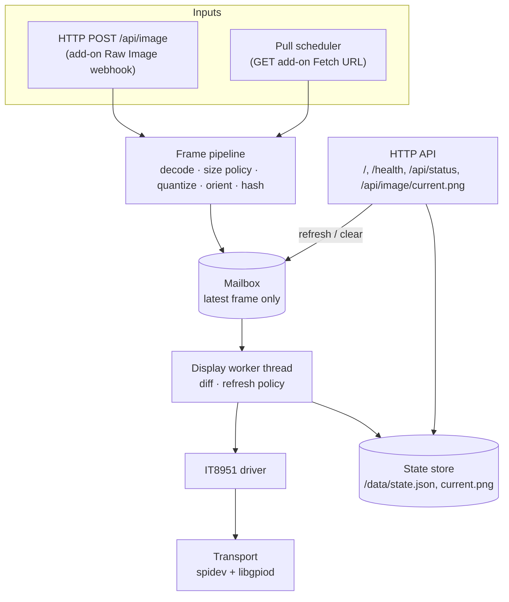
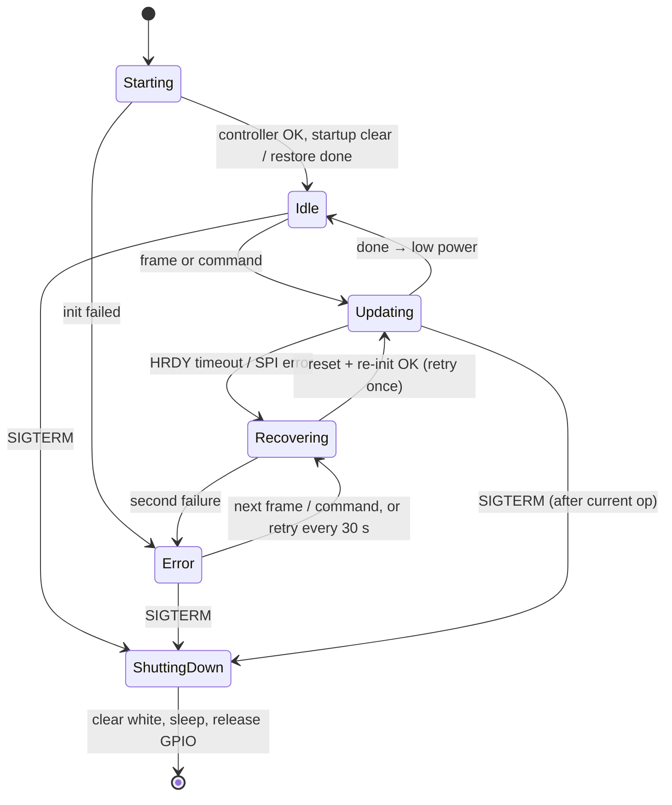
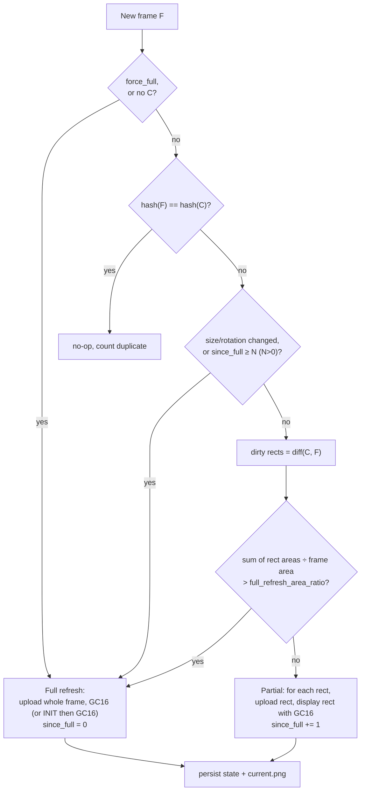
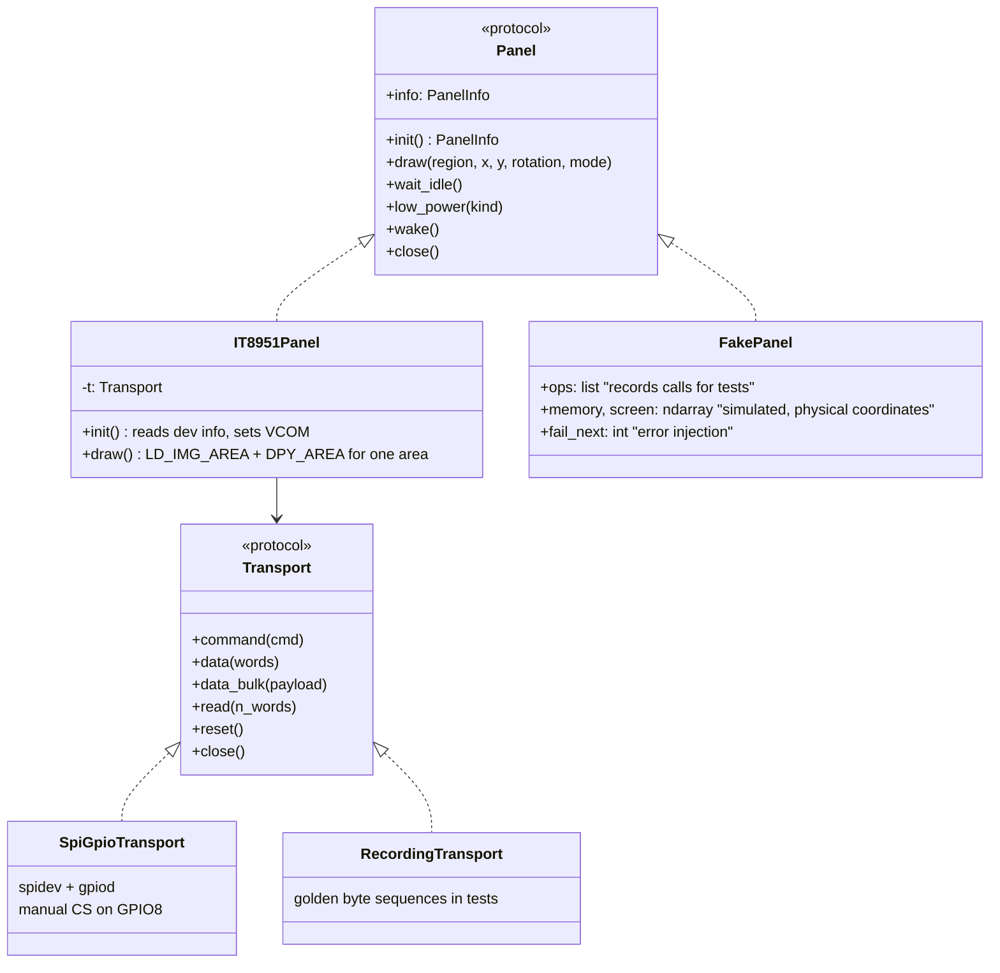
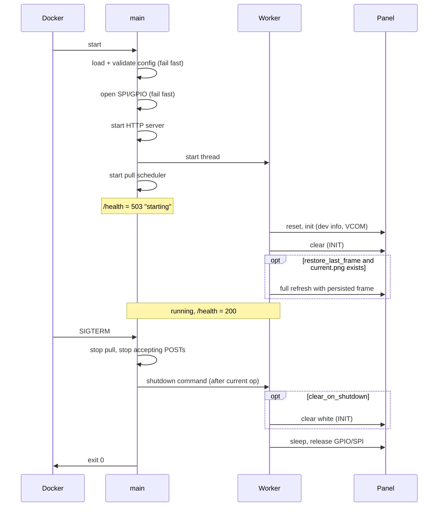
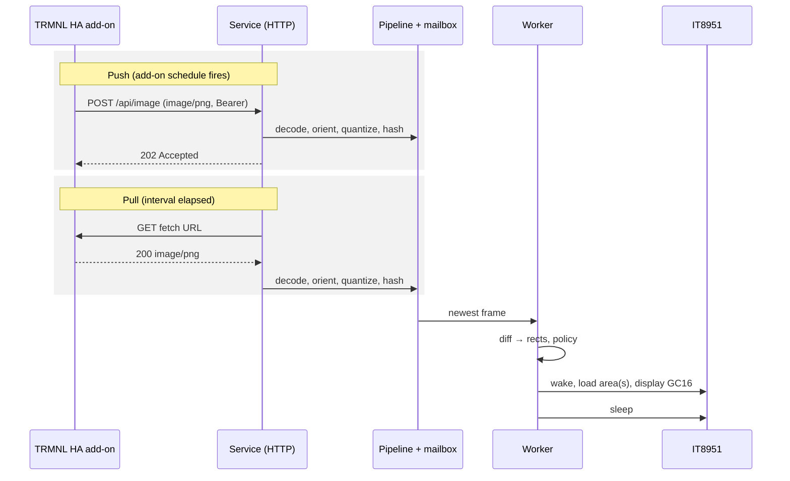
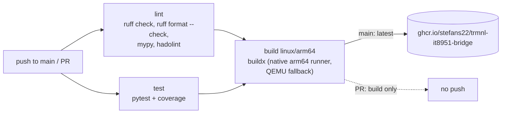

# Design

Status: **implemented** (v0.1.0, not yet run on hardware as a service). Implements [requirements.md](requirements.md). Configuration reference: [configuration.md](configuration.md).
This document describes *how* the system works. The reasons behind decisions are in the [ADRs](adr/README.md).

## 1. Overview

One container, one process, three concerns:

1. **Inputs:** an HTTP push endpoint and a pull scheduler. Both produce raw image bytes.
2. **Frame pipeline:** decode → size policy → quantize to 16 levels → mirror/rotate → hash (for deduplication).
3. **Display worker:** a single thread that owns the panel. It diffs each new frame against the one on the panel, chooses a partial or full refresh, and drives the IT8951 over SPI/GPIO.



## 2. Technology choices

| Concern | Choice | ADR |
|---------|--------|-----|
| Language | Python 3.12 | [0002](adr/0002-python.md) |
| HTTP | FastAPI + uvicorn (OpenAPI at `/docs`) | |
| Config | pydantic-settings + PyYAML | [0007](adr/0007-config-yaml-and-env.md) |
| Imaging | Pillow + numpy | |
| HTTP client | httpx | |
| Hardware | `spidev`, `gpiod` (libgpiod v2), manual CS | [0003](adr/0003-kernel-interfaces-spidev-gpiod.md), [0004](adr/0004-manual-chip-select.md) |
| Tooling | uv, ruff (lint + format), mypy (strict), pytest, hadolint | |
| Build | linux/arm64, GitHub Actions → GHCR | [0012](adr/0012-arm64-ghcr.md) |

## 3. Components

### 3.1 Configuration (`config.py`)

- A pydantic `Settings` model with nested sections: `panel`, `display`, `push`, `pull`, `server`, `storage`, `log`.
- Sources, from lowest to highest precedence: defaults → YAML file → environment.
- File path: `EPD_CONFIG_FILE`, default `/config/config.yaml`. A missing file is fine if every required value comes from the environment.
- Env scheme: prefix `EPD_`, nested delimiter `__`, case-insensitive. Example: `display.full_refresh_every` ⇔ `EPD_DISPLAY__FULL_REFRESH_EVERY`. Maps and lists are given as JSON.
- Secrets (`push.token`, `pull.headers`) use `SecretStr` and are redacted in logs and status.
- See [configuration.md](configuration.md) for every key.

### 3.2 Inputs

**Push (`POST /api/image`)**

- The body is the raw image (`image/png`, `image/jpeg`). This is exactly the add-on's *Raw Image* webhook (`Authorization: Bearer <token>` is optional on their side).
- Checks run in this order: auth (`401`) → `Content-Length`/streamed size against `push.max_body_bytes` (`413`) → decode (`400`) → size policy (`422`).
- It returns `202 Accepted` with `{"frame_id", "hash", "duplicate": bool}` once the frame is in the mailbox. It does not wait for the panel, because the add-on's webhook call shouldn't block for seconds.
- Optional query parameter `?refresh=full` forces a full refresh for this frame.

**Pull scheduler**

- An asyncio task: `GET pull.url` with `pull.headers`, timeout `pull.timeout_s`, every `pull.interval_s`. The first run happens right at startup if `pull.on_start`.
- On failure: exponential backoff (×2, capped at `pull.backoff_max_s`), then back to the normal interval after a success.
- `ETag`/`If-None-Match` is sent if the server provides one. Deduplication by frame hash covers the case where it doesn't.
- Note: the add-on's on-demand Fetch URL launches a Chromium render on each request (several seconds of CPU on the add-on host). The docs recommend long intervals, or pulling a cached schedule output if your add-on version serves one (open point O-2).

**Push and pull together:** both feed the same mailbox, and the newest *received* frame wins. If both sources render the *same* dashboard, deduplication makes the redundant one a no-op. If they render *different* dashboards, the panel alternates between them. That's expected and documented.

### 3.3 Frame pipeline (`pipeline.py`)

Runs in a worker thread (`anyio.to_thread.run_sync`), off the event loop.

1. **Decode** with Pillow (PNG, JPEG, BMP, GIF, WebP). Images larger than 4× the panel area are rejected from the header, before the pixels are decoded (decompression-bomb guard).
2. **Flatten** alpha onto white, convert to `L` (8-bit gray).
3. **Size policy** against the *logical* resolution (physical size with rotation applied): `reject` | `fit` (scale while keeping the aspect ratio, letterbox white) | `stretch`.
4. **Quantize** to 16 levels: `round(v × 15 / 255)`, or Floyd-Steinberg onto the 16-gray palette if `display.dither` is on. The result is the **preview** (logical orientation), used for the status page and `current.png`.
5. **Mirror** (software, if `mirror_x`/`mirror_y`; the controller can't mirror). The mirror axes are physical, so at 90°/270° a physical x-mirror is a logical y-mirror. Rotation is **not** applied here, because the controller does it during upload ([ADR 0008](adr/0008-rotation-by-controller.md)). With `rotation_via_controller: false` the rotation is applied here too, and the frame is physical from this point on.
6. **Hash:** BLAKE2b of the quantized frame (including its shape and rotation).

The result is a `Frame(id, source, received_at, pixels, preview, rotation, hash, force_full)`. `pixels` is in **frame coordinates**: logical (image) coordinates when the controller rotates, physical coordinates in the fallback. `rotation` is what the driver passes to the controller (`display.rotation`, or `0` in the fallback).

### 3.4 Mailbox

A single-slot, thread-safe holder (a `threading.Condition`). `put_frame()` replaces any frame that is pending but not yet drawn, which gives coalescing (FR-15). Manual commands (`REFRESH_FULL`, `CLEAR`, `SHUTDOWN`) go through the same object via `put_command()`, so the worker is the only thing that ever touches the panel. Commands are handled in order before a pending frame; `SHUTDOWN` jumps the queue.

### 3.5 Display worker (`worker.py`)

A dedicated non-async thread, because SPI and GPIO calls block.



**Refresh policy for a new frame `F` against the current frame `C`:**



`since_full` counts partial updates since the last full refresh. It is persisted so that container restarts don't reset the ghosting cadence.

### 3.6 Diff algorithm (`diff.py`)

Input: two frames of the same shape (values 0–15) in frame coordinates. Output: a list of aligned rectangles in frame coordinates. The driver maps them to physical coordinates (§3.7).

1. `mask = C != F`. If nothing changed, return `[]`.
2. Reduce to a **tile grid** (`display.tile_size`, default 32 px): a tile is dirty if any pixel in it is. This is cheap (`mask.reshape(...).any(axis=(1,3))`) and absorbs dithering noise.
3. Find **connected components** of dirty tiles (8-connectivity, a small BFS over a grid of at most 38×26 tiles) and take each component's bounding box.
4. **Merge:** greedily merge two boxes when the area of their union is at most `(a+b) × 1.3` (it costs little extra area to save one display command). Then, while there are more than `display.max_rects` boxes (default 8), merge the pair whose union adds the least area.
5. **Align:** for 4bpp, the IT8951 packs 4 pixels per 16-bit word, so `x` and `w` of the *uploaded* area must be multiples of 4. Tile boundaries guarantee this except at the right edge of a frame whose width isn't a multiple of 4 (portrait 9.7": 825 px). There the row is padded with white to the next word. The smoke test confirmed that the controller accepts this. Rects are clamped to the frame. (Some firmwares, `M641` for 6" panels, also need 32 px alignment in *physical* x. That isn't implemented, because only the 9.7" `M841` panel is in scope.)

All of this is pure numpy/Python and fully unit-tested (property tests: every changed pixel is covered by some rectangle, rectangles stay inside bounds, rectangles are aligned).

### 3.7 IT8951 driver (`driver/`)

Layers:



**Protocol** (ported from `docs/waveshare/IT8951-ePaper/Raspberry/lib/e-Paper/EPD_IT8951.c`):

- SPI mode 0, MSB first, 16-bit words sent big-endian.
- Each transaction: wait until HRDY is high → CS low → preamble word (`0x6000` command, `0x0000` write data, `0x1000` read data) → wait HRDY → payload → CS high. Reads send one dummy word before the data.
- **CS is driven manually on GPIO8**, because a bulk pixel write has to stay in *one* CS-low window that spans many SPI transfers. This is why the host uses `dtoverlay=spi0-0cs` (see README). spidev's `writebytes2` splits the payload into chunks of the kernel's `spidev.bufsiz` (default 4096 B) inside the same CS window, so no `bufsiz` change is needed.
- Pins (BCM): RST 17, HRDY 24, CS 8. All are configurable.

**Init:** RST pulse → `SYS_RUN (0x0001)` → `GET_DEV_INFO (0x0302)`, which gives panel W/H, image buffer address, FW and LUT version strings → enable packed write (`I80CPCR = 0x0001`) → read VCOM (`0x0039`) and set it to `|vcom| × 1000` if it differs → optionally "enhance driving" (reg `0x0038 = 0x0602`). Init fails if the device info is implausible (corrupted SPI data) or if `panel.expected_width/height` are set and differ. The controller forgets VCOM on reset (smoke test), so it is set on every init.

**Area update** (`draw`, one call per rect): wait for the display engine to be idle (`LUTAFSR == 0`) → set target address (`LISAR`) → `LD_IMG_AREA (0x0021)` with `[endian=little, bpp=4, rotate=r], x, y, w, h` (frame coordinates) → packed 4bpp pixel words → `LD_IMG_END (0x0022)` → `DPY_AREA (0x0034)` with the rect in **physical** coordinates and `mode`. A full refresh and a clear are the same call with the whole frame. Waiting for idle before the next load is required so a running waveform's source buffer isn't overwritten.

**Rotation** ([ADR 0008](adr/0008-rotation-by-controller.md)): the controller's rotate codes turn the image *counter-clockwise* (smoke test), so for the clockwise `display.rotation` the code is `r = ((360 − rotation) mod 360) / 90`, or `0` in the software fallback. A pure function `to_physical(rect, rotation, panel_w, panel_h)` maps frame rects to panel rects for `DPY_AREA`, for example 90° clockwise: `(x, y, w, h) → (W − y − h, x, h, w)` with `W` the physical width. The smoke test confirmed that `LD_IMG_AREA` takes logical coordinates. `FakePanel` implements the same semantics in software, so tests cover the mapping.

**Waveform modes** for M841 (9.7"): `INIT=0`, `GC16=2`, `A2=6`. Partial updates use GC16 (16-level, flicker-free within the rect). DU/A2 are not used (out of scope).

**Pixel packing:** the exact nibble and byte order within a word is pinned by a golden test that reproduces the Waveshare reference (`GUI_Paint.c` packing plus little-endian load, sent through `WriteMultiData`). This matters, because the wrong order gives a visually shuffled image.

**Throughput (measured on the Pi 3, smoke test):** full frame 495 KB uploads in 0.34 s at 12 MHz. The GC16 waveform takes about 0.5 s regardless of area size. A full GC16 update takes 0.9 s, an area update about 0.5 s, and an INIT clear 1.6 s.

**Low power:** after each operation the worker waits for the display engine to be idle, then sends `SLEEP (0x0003)` or `STANDBY (0x0002)` per `panel.low_power`. `SYS_RUN` wakes the controller before the next operation. On shutdown it always sends `SLEEP`.

### 3.8 State store (`state.py`)

- `/data/state.json`: `since_full`, counters, current frame (id, source, hash, timestamps). The last error and the last update are kept in memory only.
- `/data/current.png`: the frame's preview, i.e. the image in logical orientation as it is shown on the panel. It is deleted when the panel is cleared via the API, and kept on shutdown so it can be restored on the next start.
- Writes are atomic (temp file + `os.replace`). There is one write per panel update, so SD card wear is negligible.
- `storage.persist: false` keeps everything in memory only.
- `storage.keep_images: N` (debugging, default `0` = off) saves every received image unchanged, including rejected ones, as `/data/images/<UTC timestamp>-<source>.<png|jpg|bin>` and deletes all but the newest N. This happens before decoding and is independent of `persist`.

### 3.9 HTTP API

| Method & path | Purpose | Notes |
|---------------|---------|-------|
| `POST /api/image` | Push a frame | Bearer token if configured. `?refresh=full`. `404` if push is disabled, `503` until the panel is initialised |
| `POST /api/refresh` | Full refresh of the current frame | Bearer token if configured |
| `POST /api/clear` | Clear the panel to white (current frame → none) | Bearer token if configured |
| `GET /health` | Liveness and readiness | `200 {"status":"ok"}` / `503 {"status":"starting" or "error", "reason":...}`. Pull failures do **not** affect health, because the add-on being down shouldn't restart this container. |
| `GET /api/status` | JSON status (FR-21) | |
| `GET /api/image/current.png` | Image currently on the panel | `404` if none. `Cache-Control: no-cache`, `ETag` = hash |
| `GET /` | HTML status page | Inline CSS/JS, polls `/api/status` every 5 s, buttons for refresh/clear |
| `GET /docs` | OpenAPI UI | Generated by FastAPI |

The `push.token`, if set, protects all `POST` endpoints. `GET` endpoints are always open (trusted network).

### 3.10 Lifecycle



The HTTP server starts before the panel is ready, so `/health` and the status page work during startup. Until the first panel init succeeds, push answers `503`, and pull counts as a failed attempt and backs off. If the init fails, the worker retries every 30 s, and `/health` reports the error.

The Docker stop grace period has to cover one update plus a clear (about 5 s). The compose example sets `stop_grace_period: 30s`.

### 3.11 Push and pull sequences



## 4. Project layout

```text
.
├── README.md                    # overview, host setup, quick start
├── pyproject.toml               # deps, ruff, mypy, pytest config
├── uv.lock
├── Dockerfile
├── compose.example.yaml
├── config.example.yaml
├── .github/workflows/ci.yml
├── src/trmnl_it8951_bridge/
│   ├── __main__.py              # entrypoint, logging, panel construction, uvicorn
│   ├── config.py                # settings model (file + env)
│   ├── runtime.py               # wires worker, mailbox, pull, status; submit()
│   ├── app.py                   # FastAPI routes, auth, body limit
│   ├── pull.py                  # pull scheduler with backoff/ETag
│   ├── pipeline.py              # decode, size policy, quantize, mirror/rotate, hash
│   ├── geometry.py              # Rect, logical<->physical mapping, controller rotate codes
│   ├── diff.py                  # tile diff -> rects
│   ├── policy.py                # skip / partial / full decision
│   ├── mailbox.py
│   ├── worker.py                # display thread, recovery, startup/shutdown
│   ├── state.py                 # status + state.json/current.png
│   ├── static/index.html        # status page
│   └── driver/
│       ├── base.py              # Panel protocol, PanelInfo, Waveform
│       ├── packing.py           # 4bpp packing
│       ├── it8951.py            # protocol
│       ├── transport.py         # spidev + gpiod (v1/v2 bindings)
│       └── fake.py              # simulated panel (tests, panel.driver=fake)
├── tests/                       # unit tests, no hardware
├── tools/hw_smoketest.py        # manual on-device test, standalone (docs/hardware-smoke-test.md)
└── docs/
    ├── requirements.md
    ├── design.md
    ├── configuration.md
    ├── hardware-smoke-test.md
    ├── adr/                     # architecture decision records
    └── waveshare/               # vendor reference (not shipped)
```

## 5. Testing strategy

| Level | What | How |
|-------|------|-----|
| Unit | config precedence and validation, pipeline (orientation, size policy, quantize), diff properties, refresh policy, mailbox coalescing, state persistence | pytest, hypothesis for diff properties |
| Driver | command and byte sequences for init, area load, display, sleep; 4bpp packing | `RecordingTransport` with golden sequences derived from the Waveshare C code |
| Integration | Worker thread with `FakePanel` (startup, partial/full, cadence, commands, recovery, restore, shutdown, portrait); HTTP API end to end: push → panel ops, auth, limits, status, current.png; pull against a mock transport | httpx `ASGITransport` / `MockTransport`, anyio |
| Hardware | gray bars, partial rect update, full refresh, clear | `tools/hw_smoketest.py`, run by hand on the Pi. Not in CI |

Coverage target: ≥ 90 % excluding `driver/transport.py`.

## 6. Container and CI

**Image**

- Multi-stage: builder (`python:3.12-slim-bookworm` + uv) → runtime (`python:3.12-slim-bookworm`, venv copied over).
- Runs as non-root user `app` (uid 1000). Device access comes from `group_add` with the host's `spi` and `gpio` GIDs (see README).
- `EXPOSE 8080`, volume `/data`, config read from `/config/config.yaml` (mounted read-only by compose), `STOPSIGNAL SIGTERM`, and a `HEALTHCHECK` using Python `urllib` against `/health` (port from `EPD_SERVER__PORT`, default 8080), so no curl is needed.
- `spidev` and `gpiod` are compiled in the build stage (`gpiod` bundles the libgpiod C sources, so only gcc is needed).
- Platform: `linux/arm64` only.

**Workflow (`.github/workflows/ci.yml`)**



- Login with `GITHUB_TOKEN` (`permissions: packages: write`). Tags come from `docker/metadata-action`. Image labels link to the repo (`org.opencontainers.image.source`).
- Native `ubuntu-24.04-arm` runners are used if available to the repository, which is much faster than QEMU.

## 7. Risks

| Risk | Mitigation |
|------|-----------|
| `spi0-0cs` overlay doesn't expose `/dev/spidev0.0` on the target kernel | Verify on the device first (hardware smoke test). Fallback: keep the normal SPI overlay and move CS to another GPIO with the HAT wired accordingly, or use spidev with `cs_change` and one large transfer (needs `spidev.bufsiz`). |
| Pixel nibble order is wrong | Golden test from the reference implementation, plus the smoke test with gray bars. |
| Controller rotation behaves differently than assumed (coordinate space, direction, odd widths in portrait) | Smoke test with an asymmetric marker in all four rotations. Fallback `display.rotation_via_controller: false` without code changes ([ADR 0008](adr/0008-rotation-by-controller.md)). |
| GC16 partial updates accumulate ghosting faster than expected | `full_refresh_every` and `full_refresh_area_ratio` are configurable. `full_refresh_waveform: init_then_gc16` is an option. |
| Python SPI throughput too low | Not an issue: the smoke test measured 11.6 Mbit/s at 12 MHz. The SPI speed is configurable. |
| Add-on's on-demand render is slow or heavy | Long pull interval, push as the primary source, cached output URL (O-2). |
