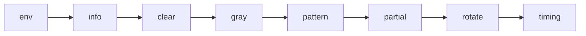

# Hardware smoke test

`tools/hw_smoketest.py` checks the hardware assumptions of the design on the real Pi and panel, before the service is implemented. Its results decide [ADR 0004](adr/0004-manual-chip-select.md) (manual chip select) and [ADR 0008](adr/0008-rotation-by-controller.md) (rotation by the controller).

The script is standalone: Python standard library plus `spidev` and `gpiod`. It supports both the libgpiod v1 and v2 Python bindings. It doesn't need the container, numpy or Pillow.

## Prerequisites

- The host setup from the [README](../README.md#host-requirements) is done (`dtoverlay=spi0-0cs`, reboot).
- The panel's VCOM value from the FPC cable.

```sh
sudo apt install python3-spidev python3-libgpiod
```

## Run

```sh
python3 tools/hw_smoketest.py --vcom -1.50
```

Run it as a user in the `spi` and `gpio` groups, or with `sudo`. The script shows a pattern on the panel, then asks you to judge it: `y`/`n`, a choice, or `s` to skip. If you answer `n`, it asks what you saw. At the end it clears the panel, puts the controller to sleep and writes **`smoketest-report.md`**. Send that file back to continue the implementation.

Useful options:

| Option | Purpose |
|--------|---------|
| `--steps env,info,gray` | Run a subset (default: all steps, in order) |
| `--rotations 90` | Only test some rotations |
| `--odd-width trunc` | Second attempt if portrait (825 px wide) shows a sheared or striped image with the default `pad` |
| `--speed 2000000` | Lower SPI clock if device info is garbage or the image is noisy |
| `--enhance` | Waveshare's "enhance driving capability", for blurry output |
| `--yes` | Don't ask, just run (visual checks are reported as unverified) |
| `--keep-image` | Leave the last image on the panel |
| `--dry-run DIR` | No hardware: simulate the controller and write each screen as a PGM into `DIR` |

Ctrl+C or SIGTERM still clears the panel and writes the report.

## Steps



| Step | What happens | What it verifies |
|------|--------------|------------------|
| `env` | Checks board, kernel, `config.txt`, device nodes and permissions, Python modules | Host setup (README) |
| `info` | Reset, `SYS_RUN`, read device info, set and read back VCOM | SPI, manual CS on GPIO 8, HRDY handshake ([ADR 0004](adr/0004-manual-chip-select.md)). Plausible values here mean the bus works. |
| `clear` | Full white with the INIT waveform | Full-frame upload, INIT mode |
| `gray` | 16 vertical gray bars, GC16 | 4bpp packing, gray order (black on the left) |
| `pattern` | 1-px frame, diagonals, single pixels, 4-px gradient stripes | Pixel order inside a 16-bit word (wrong order gives zig-zag diagonals and scrambled stripes) |
| `partial` | Three area updates, then one undone | Area upload + `DPY_AREA` only refreshes the area; partial GC16 ghosting ([ADR 0005](adr/0005-partial-updates-tile-diff.md)) |
| `rotate` | For each rotation: an asymmetric marker (thick bar = "up", an "F", 1–4 squares = rotation code, an arrow along +x), then a partial box in logical coordinates | The controller's rotate flag: direction, whether `LD_IMG_AREA` takes logical coordinates, the logical→physical mapping for `DPY_AREA`, and 825-px-wide rows in portrait ([ADR 0008](adr/0008-rotation-by-controller.md)) |
| `timing` | Times packing, full upload and full GC16 separately | Throughput, SPI speed headroom (NFR-1) |

### Reading the rotate step

Hold the panel in its normal landscape position, the same as during the `gray` step (black bar on the left). For each rotation, the script asks which physical edge shows the thick black bar.

Rotation *r* turns the image *r* degrees **clockwise**. The script sends the controller code for that; the controller itself rotates counter-clockwise, see ADR 0008.

| Rotation | Expected edge of the bar |
|----------|--------------------------|
| 0 | top |
| 90 | right |
| 180 | bottom |
| 270 | left |

- If the box in the partial sub-step doesn't appear, or only partly, the script refreshes the whole panel to show where the pixels were actually loaded. Describe what you see in the note.
- A sheared or striped image in portrait (rotation 90/270) points to the 825-px row-width problem. Run it again with `--rotations 90,270 --odd-width trunc`.

## Troubleshooting

| Symptom | Likely cause |
|---------|--------------|
| `env`: `/dev/spidev0.0` missing | `spi0-0cs` overlay doesn't create spidev on this kernel. See the fallback in ADR 0004. |
| `env`: no permission | User not in the `spi`/`gpio` groups (log in again after adding), or run with `sudo` |
| `open SPI and GPIO` fails with "Device or resource busy" | GPIO 8/17/24 is claimed by something else, e.g. `dtparam=spi=on` still active, which claims CS0 |
| `info`: HRDY timeout | Wiring, the HAT's interface switch not set to SPI, or no 5 V supply to the HAT |
| `info`: garbage width/height/LUT | Corrupted SPI data: lower `--speed`, check the CS pin |
| `gray` OK, `pattern` zig-zag | Nibble or byte order in `pack_row()` is wrong. Report it; it's a one-line fix. |
| Blurry image | Try `--enhance` |
