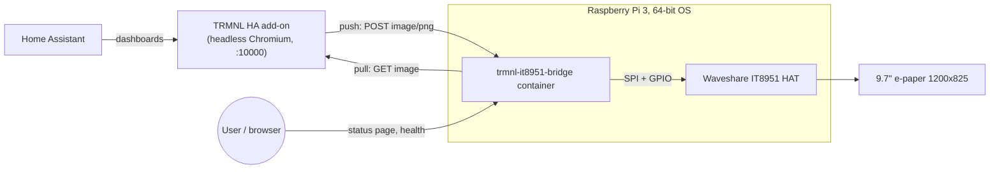

# Requirements

Status: **agreed**; implemented in v0.1.0.
Companion documents: [design.md](design.md), [../README.md](../README.md) (host setup).

## 1. Purpose

Show Home Assistant dashboards, rendered by the
[TRMNL HA add-on](https://github.com/usetrmnl/trmnl-home-assistant) (`trmnl-ha`),
on a Waveshare IT8951-based e-paper panel attached via SPI to a Raspberry Pi 3.
The software ships as an OCI container.

## 2. Glossary

| Term | Meaning |
|------|---------|
| Add-on | The TRMNL HA add-on (`trmnl-ha`). It renders dashboards to images. It is a Home Assistant *add-on*, not an *integration*. |
| Push | The add-on POSTs a rendered image to this service (its "Raw Image" webhook format). |
| Pull | This service periodically GETs an image from the add-on (its "Fetch URL"). |
| Frame | A decoded, oriented, 16-level grayscale image of exactly the panel's logical resolution. |
| Partial update | Refreshing only the rectangle(s) of the panel whose pixels changed. |
| Full refresh | Refreshing the whole panel, with a flashing waveform that removes ghosting. |
| VCOM | Panel-specific voltage printed on the panel's FPC cable. It must be set correctly. |

## 3. Constraints

| ID | Constraint |
|----|-----------|
| C-1 | Runs on a Raspberry Pi 3 (1 GB RAM, 4× Cortex-A53) with a **64-bit** OS. The image targets `linux/arm64`. |
| C-2 | The panel is driven via the Waveshare IT8951 e-Paper HAT over **SPI** plus GPIO (RST, HRDY, CS). Reference material is in `docs/waveshare/`. |
| C-3 | The reference hardware is the **9.7" e-Paper HAT, 1200×825, 16 gray levels, IT8951 firmware/LUT `M841`**. Other IT8951 panels should work through configuration but are not tested. |
| C-4 | Runs in a **trusted network**. No TLS, no user management. |
| C-5 | Host prerequisites (SPI enabled, device permissions, Docker) are documented in the project README and can be assumed to be in place. |
| C-6 | The container is built by a GitHub Actions workflow and pushed to the GitHub Container Registry of the repository (`ghcr.io/stefans22/trmnl-it8951-bridge`). |
| C-7 | Documentation is Markdown in `docs/`, and diagrams are Mermaid. |

## 4. Functional requirements

### 4.1 Image input

| ID | Requirement |
|----|-------------|
| FR-1 | **Push:** accept an image via `POST`, with the raw image bytes as the body (`Content-Type: image/png` or `image/jpeg`). This matches the add-on's *Raw Image* webhook format. |
| FR-2 | **Push auth:** if a token is configured, require `Authorization: Bearer <token>` and answer anything else with `401`. If no token is configured, the endpoint is open. |
| FR-3 | **Pull:** periodically fetch an image from a configured URL (the add-on's Fetch URL) at a configurable interval. Requests have a timeout and retry with backoff. |
| FR-4 | Push and pull can be **active at the same time**. Either source can update the panel. The most recently *received* frame wins. |
| FR-5 | Either source can be disabled by configuration. Running with both disabled is allowed (status page only) but logs a warning. |
| FR-6 | Images that cannot be decoded, or that are larger than the size limit, are rejected (`400` / `413` for push, logged for pull). They never reach the panel. |
| FR-7 | Images whose size doesn't match the logical panel resolution are handled per a configurable policy: `reject` (default), `fit` (scale and letterbox on white), or `stretch`. |

### 4.2 Display

| ID | Requirement |
|----|-------------|
| FR-10 | Frames are converted to 16 gray levels (4 bpp). Dithering is expected to be done by the add-on (`palette=gray-16`). Optional local dithering can be configured. |
| FR-11 | **Partial updates:** each new frame is compared with the frame currently on the panel. Only the changed rectangle(s) are uploaded and refreshed. |
| FR-12 | A frame identical to the current one causes **no panel activity**. |
| FR-13 | A **full refresh** runs every *N* partial updates (configurable, `0` = never), and when the changed area exceeds a configurable fraction of the panel. |
| FR-14 | Display **orientation** is configurable: rotation 0/90/180/270 and optional horizontal/vertical mirroring. The logical resolution (e.g. 825×1200 in portrait) is derived from it and shown on the status page. |
| FR-15 | At most one panel operation runs at a time. Frames that arrive while the panel is busy are coalesced: only the newest pending frame is drawn. |
| FR-16 | Between updates the controller is put into a low-power state (sleep or standby, configurable). |
| FR-17 | **Shutdown** (SIGTERM/SIGINT): finish or abort the current operation, clear the panel to white (configurable, default on), put the controller to sleep and release GPIO/SPI. |
| FR-18 | **Startup:** initialize the controller, clear the panel, then show the last persisted frame if there is one and this is enabled (configurable, default on). |
| FR-19 | Manual actions via the API: force a full refresh of the current frame, and clear the panel. |

### 4.3 Observability

| ID | Requirement |
|----|-------------|
| FR-20 | `GET /health` returns `200` when the service is running and the panel is operational, and `503` otherwise (e.g. the controller isn't responding). It is usable as a container healthcheck. |
| FR-21 | `GET /api/status` returns JSON: version, uptime, panel info (model/LUT, resolution, VCOM), orientation, current frame (source, received at, displayed at, hash), counters (partial/full refreshes, updates since the last full refresh, rejected images), last error, pull state (last attempt, last success, next run). |
| FR-22 | `GET /api/image/current.png` returns the frame as it is currently shown on the panel, in logical orientation. |
| FR-23 | `GET /` serves a small, dependency-free HTML status page that shows the current image and the status data, plus buttons for the manual actions (FR-19). |
| FR-24 | Logs are written to stdout in a structured, line-oriented format with a configurable level. |
| FR-25 | For debugging, the last *N* received images can optionally be kept unchanged in the data directory (configurable, default off). |

### 4.4 Configuration

| ID | Requirement |
|----|-------------|
| FR-30 | All settings can be set in a **YAML config file** and overridden by **environment variables** with a matching naming scheme. Precedence: built-in defaults < file < environment. |
| FR-31 | Configuration is validated at startup. Invalid or missing required values (e.g. VCOM) abort startup with a clear message. |
| FR-32 | The effective configuration (secrets redacted) is logged at startup and shown in `/api/status`. |

## 5. Non-functional requirements

| ID | Requirement |
|----|-------------|
| NFR-1 | **Latency:** a partial update of a typical dashboard change (< 25 % of the area) completes within 3 s of image receipt on a Pi 3. |
| NFR-2 | **Memory:** RSS stays below 150 MB. |
| NFR-3 | **Robustness:** a failing add-on, network errors or malformed images never crash the service. Panel errors are retried once with a controller reset, then reported via `/health`. |
| NFR-4 | **Panel care:** the VCOM is always applied. A full refresh cadence prevents ghosting buildup. The panel is cleared on shutdown. |
| NFR-5 | **Security:** runs as a non-root user with only the SPI and GPIO devices mapped (no `--privileged`). Push bodies are limited in size (default 10 MB). |
| NFR-6 | **Quality gates:** linting, type checking and unit tests run in CI on every push and PR. Everything except the low-level SPI/GPIO access is testable without hardware. |
| NFR-7 | **Build:** CI builds the `linux/arm64` image, pushes it to GHCR as `latest` on every push to `main` ([ADR 0014](adr/0014-image-tags.md)). PRs build but don't push; other branches run CI only through PRs. |
| NFR-8 | **Documentation:** README (overview, host setup, quick start), `docs/requirements.md`, `docs/design.md`, `docs/configuration.md` (generated or kept in sync with the config model), and an API reference. |

## 6. Out of scope

- TRMNL device/BYOS protocol (`/api/display`, `/api/setup`), battery reporting, the Terminus webhook format.
- Rendering dashboards on the Pi (that's the add-on's job).
- Several panels per container, touch input, color panels, A2/animation modes.
- TLS, user accounts, internet exposure.
- Architectures other than `linux/arm64`.

## 7. Decisions and open points

Decisions are recorded as [ADRs](adr/README.md).

| # | Open question | Current assumption |
|---|---------------|--------------------|
| O-2 | Pull from the on-demand render URL or from a cached schedule output (`/output/<name>.png`)? The cached output is much cheaper for the add-on, but has to be verified against the add-on version in use. | `pull.url` takes any URL. The docs recommend whichever is verified. |
